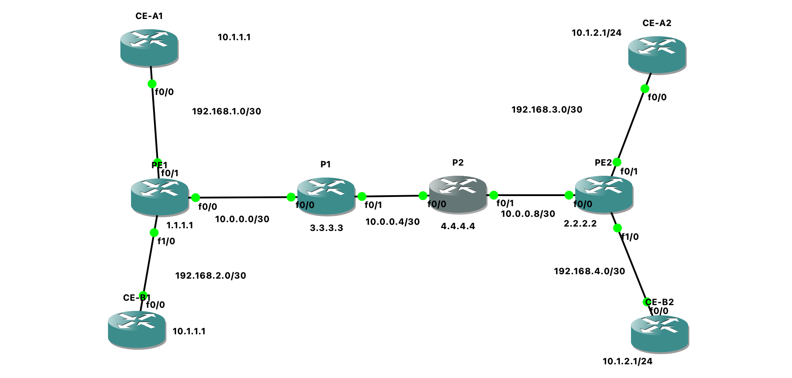

# MPLS L3VPN lab

This was my first full MPLS build. A small provider core (PE1, P1, P2, PE2) runs OSPF and LDP, and two customers, A and B, use exactly the same address ranges but never see each other. The VRFs keep them apart on the PEs, and MP-BGP VPNv4 carries their routes between PE1 and PE2.

## Topology

| Link | Addressing |
|---|---|
| PE1 Fa0/0 to P1 Fa0/0 | 10.0.0.0/30 (.1 and .2) |
| P1 Fa0/1 to P2 Fa0/0 | 10.0.0.4/30 (.5 and .6) |
| P2 Fa0/1 to PE2 Fa0/0 | 10.0.0.8/30 (.9 and .10) |
| PE1 Fa0/1 to CE-A1 | 192.168.1.0/30, VRF A |
| PE1 Fa1/0 to CE-B1 | 192.168.2.0/30, VRF B |
| PE2 Fa0/1 to CE-A2 | 192.168.3.0/30, VRF A |
| PE2 Fa1/0 to CE-B2 | 192.168.4.0/30, VRF B |

Loopback0 addresses are PE1 1.1.1.1, PE2 2.2.2.2, P1 3.3.3.3 and P2 4.4.4.4, all /32.

Both customers use 10.1.1.0/24 at site 1 (behind PE1) and 10.1.2.0/24 at site 2 (behind PE2). That overlap is on purpose, it is the whole point of the VRFs. VRF A uses RD and RT 65000:1, and VRF B uses 65000:2.

## What I practised

I started with the core: OSPF for the loopbacks, LDP on every core link, and the difference between the label table (LIB) and the one the router actually forwards with (LFIB). Then I looked at push, swap and pop, and why the second to last router removes the label (penultimate hop popping).

After that I built the VPN part: VRFs on the PEs, the difference between RD and RT, the VPNv4 session between the PE loopbacks, and the two-label stack you can see in the traceroutes. PE to CE routing is just static routes on the PE and a default route on each CE, to keep the focus on MPLS. I also tried LDP-IGP sync and broke the lab on purpose a few times.

## What is in each folder

- `configs/` has one file per device. They are rebuilt from my lab notes, not raw `show running-config` exports.
- `verification/` has the real `show` and `traceroute` output I captured, plus two screenshots.
- `notes/` has my study notes and a cheat sheet of the commands I use to debug an L3VPN.
- `troubleshooting.md` covers what went wrong and how I fixed it.

## Rebuilding it

Build the topology in GNS3 with c7200 routers. Slot 0 is `C7200-IO-2FE`, and PE1 and PE2 also need a `PA-2FE-TX` in slot 1 for the extra FastEthernet port. Paste each file from `configs/` into the matching router and save with `write memory`.

Then check in this order: `show ip ospf neighbor`, `show mpls ldp neighbor`, `show bgp vpnv4 unicast all summary`, and finally `ping 10.1.2.1 source 10.1.1.1` from CE-A1 and from CE-B1. Both pings should work even though the addresses are identical.
